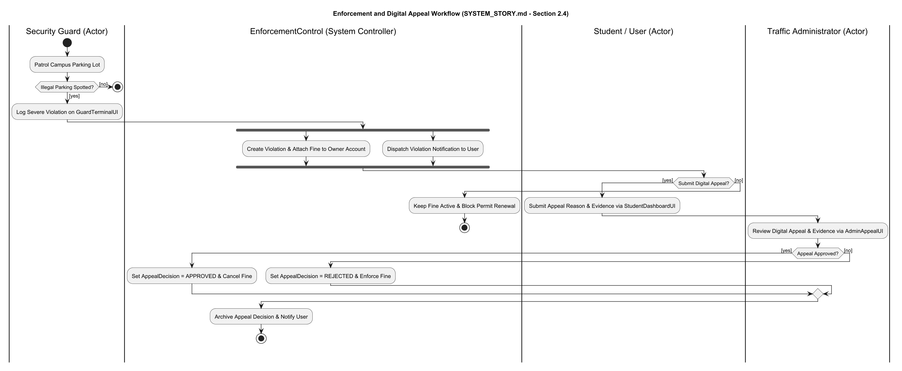
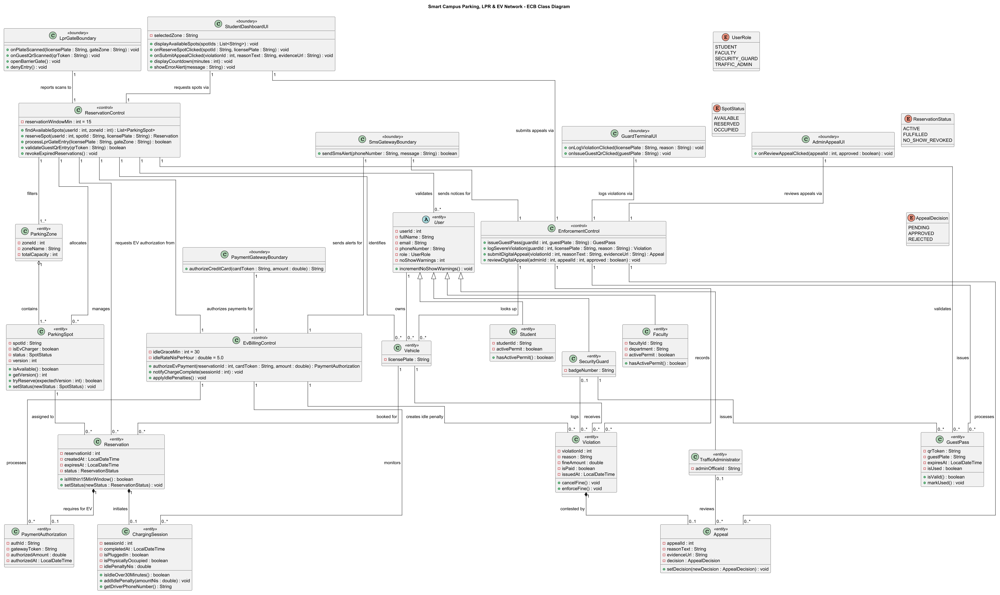
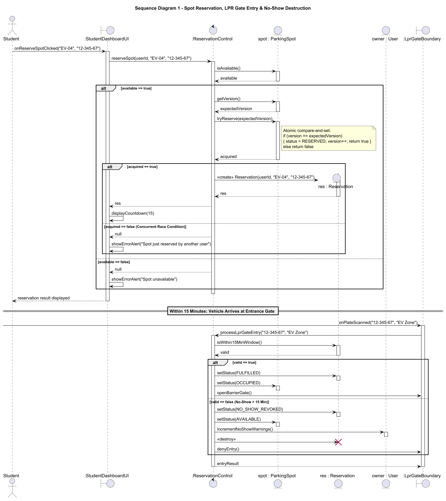
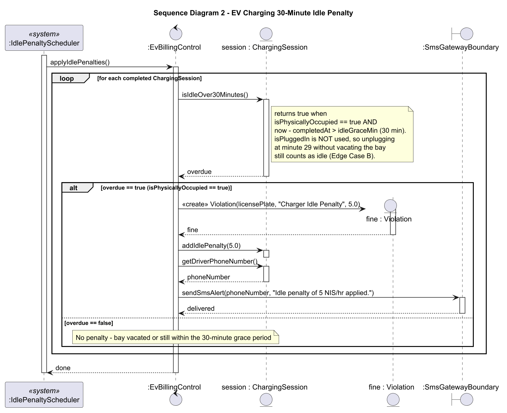

# System Architecture & Object-Oriented Design (`Ex4_SmartParking_Design`)

**Course:** 61756 Software Engineering Methods (Academic Year 2026-2027)
**Institution:** ORT Braude College of Engineering | Department of Software Engineering
**Domain:** Smart Campus Parking, LPR, and EV Network (Continued from Exercise 1)

---

## 1. Engineering Team Details

| Role | Full Name | Student ID | Braude Academic Email |
| :--- | :--- | :--- | :--- |
| **Student A (Role A)** | `[Enter Student A Full Name]` | `[Enter ID]` | `[studentA@e.braude.ac.il]` |
| **Student B (Role B)** | `[Enter Student B Full Name]` | `[Enter ID]` | `[studentB@e.braude.ac.il]` |

* **Group Number:** `G[XX]`
* **GitHub Repository URL:** `https://github.com/[Username]/Ex4_SmartParking_Design`

### Driver-Navigator Work Split
* **Student A (Role A):** Project setup; drove the ECB Class Diagram (PlantUML draft, audit, Visual Paradigm import and layout).
* **Student B (Role B):** Drove both ECB Sequence Diagrams (`<<create>>`, `alt`/`loop`, destroy `X`), imported them into Visual Paradigm, and ran the iterative consistency check against the Class Diagram.
* **Joint:** Activity Diagram (4 partitions), Part 4 design critique, `ARCHITECTURE.md`, and the GitHub push.

---

## 2. Step 1: Business Process Modeling — Activity Diagram (`Visual Paradigm`)

* **PlantUML Source:** [`diagrams/activity_appeal.puml`](diagrams/activity_appeal.puml)
* **Visual Paradigm Model:** [`SystemModel_Ex4.vpp`](SystemModel_Ex4.vpp)
* **Partitions / Swimlanes:** Separates external **Actors** (`Security Guard`, `Student / User`, `Traffic Administrator`) from the internal **System Controller** (`EnforcementControl`), using `initial node`, `fork`/`join` (AND), `decision` (XOR) with explicit `[guards]`, `merge` (OR), and `activity final node`.

| UML 2.5 Element | Where it appears in the workflow |
| :--- | :--- |
| Initial Node | Start of the guard's patrol (`Security Guard` partition) |
| Decision (XOR) | `Illegal Parking Spotted?`, `Submit Digital Appeal?`, `Appeal Approved?`, each with `[yes]` / `[no]` guards |
| Fork / Join (AND) | `EnforcementControl` runs *Create Violation & Attach Fine* and *Dispatch Violation Notification* in parallel; the Join waits for both |
| Merge (OR) | Recombines the `APPROVED` / `REJECTED` branches before *Archive Appeal Decision & Notify User* |
| Activity Final Node | No violation found; no appeal submitted (fine stays active, permit renewal blocked); appeal decision archived |



---

## 3. Step 2: Structural Modeling — ECB Class Diagram (`PlantUML` -> `Visual Paradigm`)

Following the **ECB (Entity-Control-Boundary)** architectural pattern:

| ECB Stereotype | Classes in System | Architectural Responsibility |
| :--- | :--- | :--- |
| **`<<boundary>>`** | `StudentDashboardUI`, `GuardTerminalUI`, `AdminAppealUI`, `LprGateBoundary`, `PaymentGatewayBoundary`, `SmsGatewayBoundary` | Interfaces with external Actors and external hardware/payment/SMS systems. Communicates ONLY with `<<control>>` classes. |
| **`<<control>>`** | `ReservationControl`, `EvBillingControl`, `EnforcementControl` | Multiple specialized controllers orchestrating business rules, timers, concurrency checks, and workflows. |
| **`<<entity>>`** | `User` (`Student`, `Faculty`, `SecurityGuard`, `TrafficAdministrator`), `GuestPass`, `Vehicle`, `ParkingZone`, `ParkingSpot`, `Reservation`, `PaymentAuthorization`, `ChargingSession`, `Violation`, `Appeal` + 4 UML `enum`s | Passive domain data classes storing persistent business state and domain helper methods. |

### Controller Responsibilities

| Controller | Owns these business rules | Boundaries it serves | Entities it manages |
| :--- | :--- | :--- | :--- |
| `ReservationControl` | Zone filtering (Student Zone vs. all zones), 15-minute reservations, optimistic locking (`tryReserve`), LPR gate entry, guest QR validation, No-Show revocation | `StudentDashboardUI`, `LprGateBoundary` | `User`, `Vehicle`, `ParkingZone`, `ParkingSpot`, `Reservation`, `GuestPass` |
| `EvBillingControl` | EV payment authorization, 100% charge SMS, 30-minute idle penalty at 5 NIS/hour | `PaymentGatewayBoundary`, `SmsGatewayBoundary` | `PaymentAuthorization`, `ChargingSession`, `Violation` |
| `EnforcementControl` | Guest QR passes, severe violations, parallel fine + notification, digital appeal workflow | `GuardTerminalUI`, `AdminAppealUI`, `StudentDashboardUI`, `SmsGatewayBoundary` | `Vehicle`, `GuestPass`, `Violation`, `Appeal` |

### Relationship Rules Applied
* **Inheritance (`<|--`)** is the ONLY relationship with an arrowhead: `User <|-- Student / Faculty / SecurityGuard / TrafficAdministrator`.
* **Aggregation (`o--`, hollow diamond):** `ParkingZone "1" o-- "1..*" ParkingSpot`.
* **Composition (`*--`, filled diamond):** `Reservation *-- PaymentAuthorization`, `Reservation *-- ChargingSession`, `Violation *-- Appeal`.
* **Plain associations (`--`)** for everything else, including `User "1" -- "0..*" Vehicle`. Zero `-->` and zero `..>` arrows.

* **PlantUML Source:** [`diagrams/class_diagram_ecb.puml`](diagrams/class_diagram_ecb.puml)
* **Visual Paradigm Model:** [`SystemModel_Ex4.vpp`](SystemModel_Ex4.vpp)



---

## 4. Step 3: Behavioral Modeling — ECB Sequence Diagrams (`PlantUML` -> `Visual Paradigm`)

### 4.1 Sequence Diagram 1: Spot Reservation, LPR Gate Entry & No-Show Destruction
* **PlantUML Source:** [`diagrams/sequence_reservation_ecb.puml`](diagrams/sequence_reservation_ecb.puml)
* `isAvailable()` -> `getVersion()` -> `tryReserve(expectedVersion)` with a nested `alt acquired == true / false` for the race condition; `<<create>>` of `res : Reservation`; at the gate, `isWithin15MinWindow()` leads to either `FULFILLED` + `openBarrierGate()` or `NO_SHOW_REVOKED` + spot release + `incrementNoShowWarnings()` + destroy `X` + `denyEntry()`.



### 4.2 Sequence Diagram 2: EV Charging 30-Minute Idle Penalty (`loop` & `<<create>>`)
* **PlantUML Source:** [`diagrams/sequence_idle_penalty_ecb.puml`](diagrams/sequence_idle_penalty_ecb.puml)
* `:IdlePenaltyScheduler <<system>>` triggers `applyIdlePenalties()`; `loop [for each completed ChargingSession]` calls `isIdleOver30Minutes()`; when overdue (physically occupied), a `fine : Violation` is created with `<<create>>`, the penalty is added to the session, and `sendSmsAlert(...)` is sent.



### 4.3 Cross-Diagram Consistency (Sequence -> Class)

| Message in Sequence Diagram | Target Class | Declared Operation in Class Diagram |
| :--- | :--- | :--- |
| `onReserveSpotClicked("EV-04", "12-345-67")` | `StudentDashboardUI` | `onReserveSpotClicked(spotId : String, licensePlate : String) : void` |
| `reserveSpot(userId, "EV-04", "12-345-67")` | `ReservationControl` | `reserveSpot(userId : int, spotId : String, licensePlate : String) : Reservation` |
| `isAvailable()` | `ParkingSpot` | `isAvailable() : boolean` |
| `getVersion()` *(added in refinement)* | `ParkingSpot` | `getVersion() : int` |
| `tryReserve(expectedVersion)` | `ParkingSpot` | `tryReserve(expectedVersion : int) : boolean` |
| `displayCountdown(15)` / `showErrorAlert(...)` | `StudentDashboardUI` | `displayCountdown(minutes : int)` / `showErrorAlert(message : String)` |
| `onPlateScanned(...)` / `openBarrierGate()` / `denyEntry()` | `LprGateBoundary` | declared with the same signatures |
| `processLprGateEntry("12-345-67", "EV Zone")` | `ReservationControl` | `processLprGateEntry(licensePlate : String, gateZone : String) : boolean` |
| `isWithin15MinWindow()` / `setStatus(...)` | `Reservation` | `isWithin15MinWindow() : boolean` / `setStatus(newStatus : ReservationStatus)` |
| `setStatus(OCCUPIED / AVAILABLE)` | `ParkingSpot` | `setStatus(newStatus : SpotStatus) : void` |
| `incrementNoShowWarnings()` | `User` | `incrementNoShowWarnings() : void` |
| `applyIdlePenalties()` | `EvBillingControl` | `applyIdlePenalties() : void` |
| `isIdleOver30Minutes()` | `ChargingSession` | `isIdleOver30Minutes() : boolean` |
| `addIdlePenalty(5.0)` / `getDriverPhoneNumber()` *(added in refinement)* | `ChargingSession` | `addIdlePenalty(amountNis : double)` / `getDriverPhoneNumber() : String` |
| `sendSmsAlert(phoneNumber, "...")` | `SmsGatewayBoundary` | `sendSmsAlert(phoneNumber : String, message : String) : boolean` |

---

## 5. Independent AI Prompt & Architectural Design Critique (Part 4)

```text
You are a senior software architect reviewing a UML 2.5 design that follows the
ECB (Entity-Control-Boundary) pattern. I have attached three files:
SYSTEM_STORY.md (the domain specification), class_diagram_ecb.puml (the class
diagram) and sequence_reservation_ecb.puml (the reservation sequence diagram).

Audit these diagrams against the two edge cases in Section 3 of SYSTEM_STORY.md:

Edge Case A - Double-Booking Race Condition: two students click "Reserve" on the
last available spot in the Student Zone at the exact same millisecond.
1. Does ParkingSpot declare a version attribute and a
   tryReserve(expectedVersion: int): boolean operation that works as an atomic
   compare-and-set?
2. In the sequence diagram, does ReservationControl read the version first, call
   tryReserve(expectedVersion), and model BOTH outcomes in a nested
   alt acquired == true / else block, so only one Reservation is created and the
   losing student gets an error alert?
3. Is there any message path where a Reservation can be created without a
   successful tryReserve()?

Edge Case B - Physical vs. Electrical EV State: an EV driver unplugs the cable at
minute 29 but leaves the car in the EV bay.
4. Does ChargingSession keep isPluggedIn and isPhysicallyOccupied as two separate
   attributes, and does isIdleOver30Minutes() depend on isPhysicallyOccupied
   rather than isPluggedIn?
5. Would this driver still receive the 5 NIS/hour Charger Idle Penalty?

General checks:
6. List every message in the sequence diagram whose target operation or parameter
   list does not exist in the class diagram.
7. List any violation of ECB separation (a <<boundary>> class linked directly to
   an <<entity>> class) and any arrow other than inheritance in the class diagram.
8. Point out any lifecycle gap, for example an object that is destroyed while
   related objects stay in an inconsistent state.

For each finding give: the file, the element, the problem, and the exact
PlantUML fix. Do not rewrite the whole diagram.
```

### Applied Improvements
* **Improvement 1 Applied (Race Condition):** Added `version: int`, `getVersion(): int` and `tryReserve(expectedVersion: int): boolean` on `ParkingSpot`. Sequence Diagram 1 now reads the version, calls `tryReserve(expectedVersion)`, and branches in a nested `alt acquired == true / else (Concurrent Race Condition)`. Only the winner gets a `<<create>> Reservation`; the other student sees `showErrorAlert("Spot just reserved by another user")`.
* **Improvement 2 Applied (EV Physical Occupancy):** Separated `isPluggedIn` from `isPhysicallyOccupied` on `ChargingSession`. `isIdleOver30Minutes()` uses only `isPhysicallyOccupied` and `completedAt`, so unplugging the cable at minute 29 without moving the car still triggers the 30-minute Charger Idle Penalty. The guard condition in Sequence Diagram 2 states this explicitly.
* **Improvement 3 Applied (AI suggestion - No-Show lifecycle gap):** The AI flagged that destroying `res : Reservation` on a No-Show left the `ParkingSpot` stuck in `RESERVED` and never updated the user's warning counter, although Section 2.2 requires it. Before the destroy `X`, Sequence Diagram 1 now calls `spot.setStatus(AVAILABLE)` and `owner.incrementNoShowWarnings()` (new lifeline `owner : User`). On successful entry it also calls `spot.setStatus(OCCUPIED)`.
* **Improvement 4 Applied (missing operations found in the consistency check):** Added `ChargingSession.addIdlePenalty(amountNis: double)` and `ChargingSession.getDriverPhoneNumber(): String` so Sequence Diagram 2 can update the accrued penalty and get the phone number for `sendSmsAlert(...)`. Added `Violation.enforceFine()` to match the *Set AppealDecision = REJECTED & Enforce Fine* action in the Activity Diagram.

---

## 6. Repository Contents

| Path | Content |
| :--- | :--- |
| `SYSTEM_STORY.md` | Official domain specification |
| `diagrams/*.puml` | PlantUML sources of all 4 diagrams |
| `diagrams/*.png` | Images exported from Visual Paradigm |
| `SystemModel_Ex4.vpp` | Visual Paradigm project with all 4 polished diagrams |
| `ARCHITECTURE.md` | This document |
| `.gitignore` | Excludes `.idea/`, `*.iml`, `*.vpp.bak`, `*.vpp.lck`, `.DS_Store`, `Thumbs.db` |

---

## 7. License
Distributed under the **ORT Braude College Academic License** (61756 Software Engineering Methods, 2026-2027).
